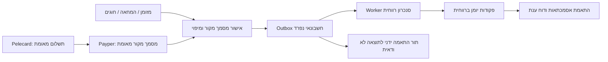

# סנכרון הנהלת חשבונות לרווחית — תכנון ובסיס עבודה

תאריך: 2026-11-15. מסמך תכנון בלבד; אין בו הרשאה לשנות Production או לשלוח מידע לרווחית.

## בסיס הייצור ששוחזר

- כתובת Production של Vercel מצביעה ל־`dpl_JCKPP1pnMUDgWv4RqYRNijyM2Gjm` (`READY`), שנוצר ב־2026-11-12 מ־CLI. מטא־דאטת הפריסה מציינת commit `01a416175c17b027660c1f77d8e4ddcf3fafed46` בענף `release/physical-terminal-prep-20261112`.
- ענף התכנון `plan/rivhit-sync-20261115` ו־worktree `.worktrees/rivhit-sync-planning` נוצרו מאותו commit. כל 632 קובצי המקור שנמצאו גם בארכיון הפריסה תואמים ב־SHA-1; שמונת הקבצים הנוספים הם שישה תוצרי build ושני קובצי מצב של Supabase. זו הוכחת התאמה למקור Vercel, לא לכל Edge Function.
- מקור `payper-issuance-worker` הפעיל (גרסה 82) הורד מ־Supabase. שמונה מתוך תשעת הקבצים תואמים מהותית למקור ה־commit; `outcome.ts` מכיל שינוי פעיל המאפשר כתובת מסמך Payper פנימית חוקית גם כשמזהה הנתיב שונה ממספר המסמך. השינוי שוחזר בענף התכנון, ולאחריו כל תשעת קובצי המקור תואמים טקסטואלית לפריסה הפעילה (בהתעלם מסיומי שורה).
- הורדו לקריאה גם `pelecard-callback`, `pelecard-order-feedback`, `pelecard-controlled-live-feedback`, `rivhit-accounting` (גרסה 112), `payment-accounting-worker` (גרסה 112), `rivhit-immediate-accounting` (גרסה 77) ו־`club-recurring-enroll`. המקורות נמצאים ב־`.tmp/rivhit-sync-prod-edge/` (מחוץ ל־Git). חלק מה־Edge Functions מכילים **גרסאות שונות של אותם קובצי `_shared`**. אין לשטח אותם אוטומטית לעץ אחד. לפני כל מימוש או deploy נדרשת התאמת מקור מפורשת לכל פונקציה וחבילת build נפרדת; גרסאות קיימות נשמרות.
- מצב Production שנבדק בקריאה בלבד: 7 אירועי `accounting_events` של רווחית, כולם `configuration_required` עם `payper_transition_hold` ו־`attempt_count=0`; אין `accounting_documents` או `accounting_customers`. בתור Payper: הצלחה אחת, שלוש `reconciliation_required` ושלוש `source_blocked`. המסמך המאושר הוא מספר `200002`, בסכום 4.00 ש״ח, המשויך לתשלום המזוהה ב־Production. אין ראיה לקליטתו ברווחית.
- ב־Production קיים שם הסוד `RIVHIT_API_TOKEN`. רישום הסוד מציג hash בלבד; התקינות, החשבון וההרשאות לא אומתו. לא נמצאו שמות ההגדרות הישנות `RIVHIT_ACCOUNT_NAMESPACE`, `RIVHIT_ACCOUNTING_MODE`, `RIVHIT_DOCUMENT_TYPE_MAP`. ההגדרות האלה שייכות למסלול *הפקת* המסמכים הישן ואינן מיפוי לפקודות יומן.

## הכרעת ממשק מוצעת, כפופה לאישור

| אפשרות | שימוש מתאים | גבול ידוע |
| --- | --- | --- |
| `Accounting.AddJournal` של רווחית Online | מועמד מועדף לרישום חשבונאי אוטומטי של מסמך Payper קיים בלי הנפקת מסמך חדש ברווחית | דורש אישור שרווחית של ענת היא Online, שה־token מורשה, שמבנה הפקודות נכון לחשבונה ושאפשר לאתר תוצאה לא ודאית. `request_reference` מופיע בבקשה, אך אין בתיעוד התחייבות לאידמפוטנטיות של `AddJournal`. |
| יבוא קובץ פקודות יומן | חלופה מבוקרת אם החשבון אינו תומך ב־API או ענת מעדיפה קליטה תקופתית | מדריך היבוא במבנה אחיד מציין שקליטת מסמכים אינה נתמכת; בהנהלת חשבונות כפולה נקלטות פקודות יומן, ובחשבונות אחרים יש לבדוק פורמט מתאים. הקליטה עשויה להיות ידנית. |
| ממשק ספק נתמך אחר | רק אם רווחית מציעה לעסק מנגנון מתאים יותר עם שמירת אסמכתת Payper | דרוש חוזה כתוב, בדיקת כפילויות ודוח התאמה. אין עדות לממשק פעיל כזה כעת. |

המלצה מותנית: לבחור `Accounting.AddJournal` רק אחרי אישור ענת ורווחית למבנה שתי פקודות עבור חשבונית־קבלה ולמנגנון התאמה אחרי timeout. אם אין חוזה כזה, לבחור יצוא קובץ מאושר עם יבוא וביקורת אנושית. אין להשתמש ב־`Document.New` או `Receipt.New` למסמך Payper קיים. רישום יומן יגרום לנתונים להופיע בדוחות הנהלת חשבונות; הוא **לא** אמור ליצור העתק של חשבונית Payper ברשימת המסמכים של רווחית.

מקורות רשמיים: [Accounting.AddJournal](https://api.rivhit.co.il/online/RivhitOnlineAPI.svc/help/operations/AddJournal), [הסבר פקודות יומן](https://rivhit-api.readme.io/docs/accounting-journals), [Status.LastRequest](https://api.rivhit.co.il/online/RivhitOnlineAPI.svc/help/operations/LastResponse), [יבוא מבנה אחיד](https://www.rivhit.co.il/knowledgebase/%D7%99%D7%91%D7%95%D7%90-%D7%A0%D7%AA%D7%95%D7%A0%D7%99%D7%9D-%D7%9E%D7%A7%D7%95%D7%91%D7%A5-%D7%91%D7%9E%D7%91%D7%A0%D7%94-%D7%90%D7%97%D7%99%D7%93/), [מגבלת API לגרסת Desktop](https://rivhit-api.readme.io/docs/test-enviornment-rivhit).

## ארכיטקטורת יעד

1. **בעלות מסמכים:** Payper נשאר מנפיק החשבונית/הקבלה במקרים שבהם נוצר בו מסמך מאומת. אין תלות בתור `accounting_events` הישן ואין שחרור של שבעת האירועים המוחזקים. בכל מקור אחר דרוש מסמך מקור חוקי מאומת לפני רישום חשבונאי; `sales.receipt_number` מקומי אינו מספיק בפני עצמו.
2. **מקור קנוני:** רישום סנכרון מוקפא מכיל `source_kind`, מזהה תשלום, מזהה מכירה/הזמנה/חיוב חוג, מערכת ומזהה מסמך מקור, מספרו וסוגו, תאריך מסמך, סכום ברוטו באגורות, פירוק מע״מ מאושר, מטבע, זהות לקוח, אמצעי תשלום, מזהי ביטול/זיכוי, גרסת מיפוי ו־hash של המטען. קישור למסמך Payper חייב להיות מאומת ממקור הספק או מביקורת מאושרת, ולא מהנחה על שדה תשלום.
3. **פקודות:** אירוע חשבונית־קבלה מתפרק לרגלי יומן נפרדות לפי אישור ענת: רגל הכנסה/מע״מ ורגל תקבול. לכל רגל מזהה `request_reference` יציב משלה, אסמכתת מספר מסמך ומזהה עסקה. חשבון לקוח, הכנסה, מע״מ, קופה/סולק, קוד מיון, תאריך ערך וכללי עיגול יוגדרו בגרסה חתומה של מיפוי. שום מספר חשבון לדוגמה מהתיעוד לא יועתק כערך Production.
4. **תור ומצבים:** `held_mapping`, `ready`, `processing`, `succeeded`, `retryable_pre_dispatch`, `reconciliation_required`, `permanent_error`, `reversed`. כניסה ל־`ready` מחייבת מסמך מקור מאומת, מיפוי מאושר, בדיקת רישום קודם והקפאת snapshot. ניסיון נשלח פעם אחת תחת claim ו־lease. שגיאה *לפני* שליחה יכולה לחזור; timeout, ניתוק או תשובה לא חד־משמעית *אחרי* אפשרות שליחה עוברים להתאמה ידנית, ללא ניסיון נוסף עד הוכחת היעדר רישום או איתור הרישום הקיים.
5. **התאמה:** לשמור `year/month/line` מתשובת `AddJournal` לכל רגל, לצד `request_reference` ומספר מסמך Payper. לקרוא `Status.LastRequest` ודוח היומן/כרטסת כראיות, בכפוף לאישור רווחית ש־lookup זה חל על `AddJournal`. תוצאת lookup חסרה אינה כשלעצמה היתר לשליחה חוזרת. לשמור הערת התאמה ופעולת מפעיל מבוקרת.
6. **תיקונים:** ביטול/זיכוי/החזר הם אירועי מקור חדשים המקושרים למסמך ולעסקה המקוריים. ענת תאשר אם נדרשת פקודת סטורנו, פקודה נגדית או מנגנון אחר, ומהו תאריך הדיווח. אין למחוק פקודה שהושלמה ואין ליצור תנועת זיכוי מתוך החזר תשלום בלבד בלי מסמך תיקון מאומת.

## מניעת כפילויות

- ייחוד מקומי על `(rivhit_account_namespace, source_system, source_document_id, journal_leg, correction_sequence)` וייחוד נוסף על `request_reference` ו־`year/month/line` כשהם ידועים. מזהה Payper 200002 לבדו אינו מפתח גלובלי: יש לשלב מזהה מסמך פנימי/ספק, סוג וחשבון.
- snapshot ומיפוי מוקפאים לפני dispatch; שינוי של סכום, לקוח או מיפוי לאחר מכן אינו משנה בקשה שכבר נשלחה.
- claim אטומי מונע שתי שליחות מקבילות. תור הפקת רווחית הישן נשאר מוחזק. ב־`AddJournal` לא מניחים ש־`request_reference` מונע כפילות בצד הספק עד אישור כתוב ובדיקת sandbox.
- תוצאה לא ודאית נעצרת להתאמה; חזרה אוטומטית מותרת רק אם הוכח שהבקשה כלל לא יצאה. השלמה היסטורית קוראת תחילה את מאגרי Payper/רווחית ומסמנת `already_recorded`, `eligible`, `needs_evidence` או `conflict`, בלי לשלוח נתונים.

## כיסוי וסדר כניסה

| מסלול | נתון קיים | תנאי לפני רישום ברווחית |
| --- | --- | --- |
| קופה באשראי דרך Pelecard/Payper | תשלום, מכירה ו־Payper ledger; מסמך אחד מאושר ב־Production | מיפוי חשבונאי, הרשאת API, בדיקת כפל ברווחית. זהו מועמד הפיילוט. |
| הזמנה באשראי | תשלום ומכירה משויכים להזמנה; Payper עתידי פעיל | מסמך Payper מאומת לכל עסקה; שתי העסקאות הישנות דורשות בירור נפרד. |
| מזומן והמחאות | `sales` ומסלול הכנה לרווחית שאינו פעיל | ענת/Payper יאשרו מי מנפיק מסמך מקור ואיך נרשם אמצעי התשלום; אין להניח ש־Payper כבר מנפיק למסלולים האלה. |
| חוגים | יש `club_memberships` ו־`recurring_charges` של iCredit; UI החוגים עבר שינויים | אימות חיובים בפועל ומסמכי מקור לכל תקופה, החלטת ענת על הכנסה נדחית/תקופת שירות וקליטת מסמך. |
| ביטול, החזר, זיכוי | מסלולי תשלום/תיקון אינם מתורגמים כיום באופן מוכח לפקודות רווחית | מסמך זיכוי/ביטול מאומת, קשר למסמך המקורי, כללי סטורנו ותאריך דיווח מאושרים. |

## מידע והרשאות חסרים — רשימת בקשה מדויקת

**מרווחית:** סוג המוצר והחברה של ענת (Online/Invoice Online/Desktop; חד־צידית/כפולה); האם `Accounting.AddJournal`, `Accounting.JournalsReport`, `Customer.List`, `Accounting.SortCodeList`, `Company.Details` ו־`Status.LastRequest` זמינים לחשבון; האם ה־token השמור מורשה לקריאות אלה ולאיזו חברה הוא משויך; סביבת sandbox נפרדת; מגבלות קצב; פורמט תאריכים ושדות אסמכתה; משמעות `request_reference` ב־`AddJournal`, זיהוי כפילות, lookup אחרי timeout וגבולות חלון חיפוש; האם קיים ממשק יבוא מועדף למקרה שה־API אינו מתאים.

**מענת:** דוגמת פקודה מאושרת לכל אחד ממסמכי חשבונית, קבלה, חשבונית־קבלה, זיכוי והחזר; מספרי כרטיסי לקוח/לקוח מזדמן, הכנסה, מע״מ, סולק, מזומן, המחאות וחוגים; קודי מיון, סוגי מע״מ ופטור, עיגול, תאריך אסמכתה ותקופת שירות; טיפול בפקודה שכבר הוזנה ידנית; אופן זיהוי המסמך בדוח שהיא מפיקה; מדיניות לתקופות סגורות; הרשאה לקריאה בלבד לדוח/כרטסת לצורך הוכחה; אישור מפורש למטען המדויק של פיילוט 200002 לפני שליחתו.

**מ־Payper/Pelecard:** דרך קריאה נתמכת למסמך קיים ולמסמך תיקון, כולל מזהה מסמך יציב, סוג, תאריך, מספר, סכום ומע״מ; אישור האם אפשר להפיק דרכם מסמכים עבור מזומן/המחאות/חיובי חוגים ומה ה־workflow; טיפול במסמכים שנכשלו או נדרשת בהם התאמה. לא נדרש שינוי של סליקה כדי לבצע גילוי זה.

## שלבי מימוש מוצעים לאחר אישור מסלול ומיפוי

1. **אישור חוזה:** אימות קריאה בלבד של החשבון, שיטות הדוח ושדות המיפוי; חתימת ענת על דוגמת פקודת 200002 ועל מסלול התוצאה הלא ודאית. החלטה בין API ליבוא קובץ. אין כתיבה לרווחית בשלב זה.
2. **תשתית מנותקת:** migration חדשה לתור `rivhit_bookkeeping_sync` ולרגלי פקודה, אילוצי ייחוד ו־RLS; מיפוי גרסאות מפורש; adapter לקריאה בלבד; worker עם מתג ברירת מחדל כבוי. אין חיבור ל־Payper issuer או לשבעת האירועים הישנים.
3. **פיילוט Payper:** יצירת מועמד 200002 בלבד מתוך מסמך מקור מאומת, dry run של שתי הפקודות, בדיקת כפל ידני ברווחית, אישור המטען והשליחה המפורשת, ואז התאמה בדוח של ענת ופעם אחת בלבד. כל פעולה חיה דורשת אישור חדש.
4. **הפעלה עתידית:** לאחר הצלחת הפיילוט, enqueue של מסמכי Payper חדשים מאומתים בלבד, עם ניטור ו־rollback באמצעות כיבוי worker; אין מחיקת פקודות שכבר נשלחו.
5. **הרחבת כיסוי:** הזמנות; מזומן/המחאות; חוגים; ביטולים/זיכויים/החזרים — כל מסלול רק אחרי אישור מסמך המקור והמיפוי שלו ובדיקת sandbox נפרדת.
6. **היסטוריה:** שאילתת גילוי read-only לכל התקופות, התאמה למספרי Payper ולפקודות שכבר קיימות ברווחית, דוח חריגים לאישור ענת, ואז batch מבוקר לפי תקופה עם ספירת לפני/אחרי ומפתח ייחודי. שבעת האירועים הישנים נשארים מוחזקים גם אחרי ההשלמה.

## קבצים, טבלאות ופונקציות צפויים

- **להוסיף רק לאחר אישור:** migration `supabase/migrations/202611150001_rivhit_bookkeeping_sync.sql`; `supabase/functions/_shared/rivhit-bookkeeping/{source,mapper,client,repository,worker,reconciliation}.ts`; `supabase/functions/rivhit-bookkeeping-worker/index.ts`; בדיקות יחידה, SQL ו־contract באותן תיקיות; מסך סטטוס מנהל נפרד או הרחבה מדודה ל־`app/src/pages/AccountingOperations.jsx`.
- **לקרוא ולהרחיב בזהירות:** `supabase/functions/_shared/payper/ledger.ts`, `outcome.ts`, `supabase/functions/payper-issuance-worker/index.ts`, `supabase/functions/_shared/payment-accounting/*` (לשמירת hold בלבד), `app/src/pages/CashRegister.jsx`, `app/src/pages/OrderPayment.jsx`, `supabase/migrations/023_clubs_and_recurring_billing.sql` ו־`supabase/functions/_shared/payment-refund.ts`. אין לשנות את זרימת התשלום או את קריאת הנפקת Payper כחלק מפיילוט היומן.
- **מקורות נתונים קיימים:** `payment_transactions`, `sales`, `orders`, `payper_document_ledger`, `payper_automatic_document_confirmation_audit`, `payper_manual_document_audit`, `club_memberships`, `recurring_charges`, `accounting_events`, `accounting_documents`, וטבלאות תשלום/תיקון פיזי לפי המסלול. אין לשנות את שורות 7 האירועים המוחזקים.
- **פונקציות קיימות לשמירה:** `capture_payper_eligible_payment`, `reserve_payper_dispatch`, `record_payper_dispatch_outcome_v2`, `hold_rivhit_pelecard_issuance`, `enqueue_verified_pelecard_accounting_event`, `claim_accounting_event` וכל Edge Function פעילה של Pelecard/Payper. המסלול החדש יקבל שמות ו־RPC משלו.

## בדיקות ופריסה בטוחה

- baseline ב־worktree: `npm ci --prefix app`, `npm test --prefix app -- --run`, `npm run build --prefix app`, בדיקות Payper/Rivhit/SQL ממוקדות, ו־`git diff --check`. אין לטעון לשימור התנהגות בלי תוצאות עדכניות.
- בדיקות חוזה עם fake provider ו־sandbox מאושר: שתי רגליים מדויקות, אפס קריאות `Document.New`/`Receipt.New`, מקסימום שליחה אחת לכל רגל, callback כפול, worker מקביל, timeout לפני/אחרי dispatch, תוצאת API לא חד־משמעית, התאמה לדוח, תיקון מסמך, עיגול ומע״מ.
- פריסה עתידית בשלבים: שחזור חבילת כל Edge Function מול הגרסה הפרוסה; migration additive על סביבת בדיקה; worker כבוי; השוואת fingerprint לתורים, תשלומים ומסמכי Payper; Preview; אישור נפרד ל־Production; פריסה כבויה; בדיקת read-only; אישור מפורש לפיילוט 200002; הפעלה למסמך יחיד; התאמה אצל ענת; ניטור. עצירה היא כיבוי worker, לא rollback של רישום שכבר נקלט.

## שער החלטה

אין להתחיל מימוש חשבונאי או להעביר נתון אמיתי עד שאושרו **הממשק**, **מיפוי הפקודות** ו**כללי ההתאמה/מניעת כפילויות**. בפרט, יש לקבל מרווחית תשובה מחייבת לגבי `AddJournal` אחרי timeout; עד אז retry אוטומטי אחרי dispatch אסור.
